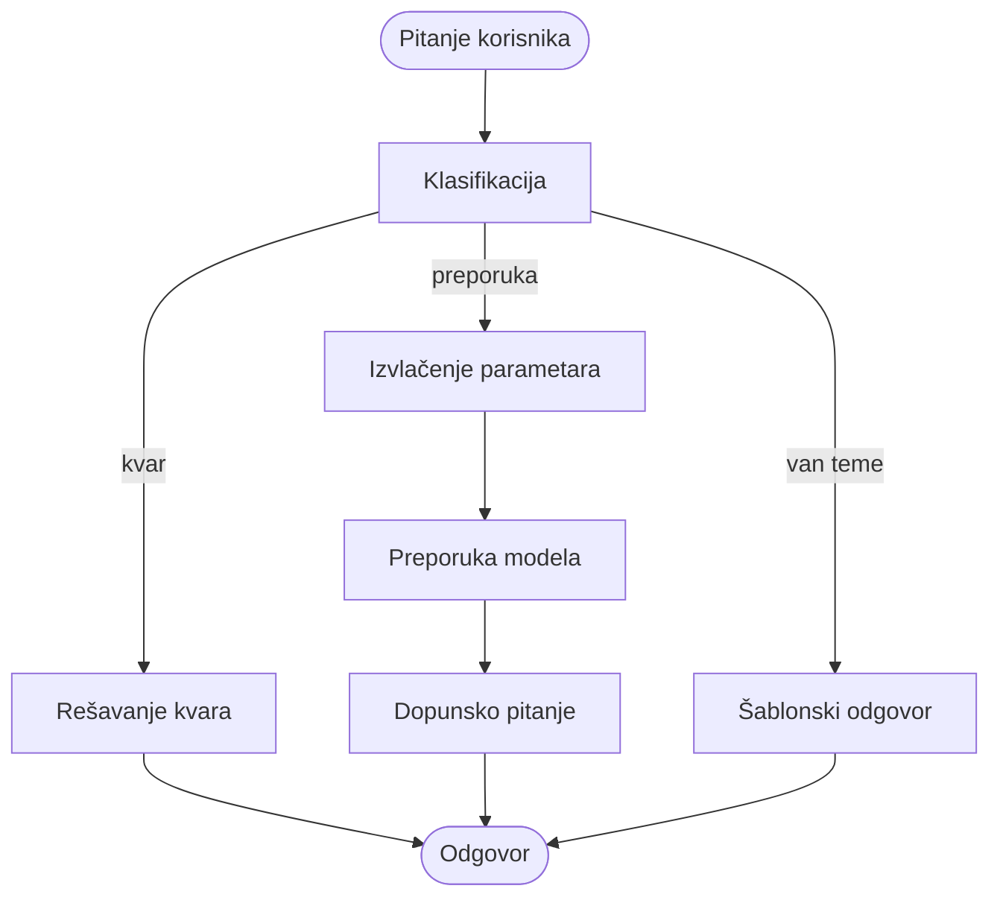

# Chatbot za preporuku Galeb fiskalnih kasa

Inteligentni asistent koji korisnicima pomaže da izaberu odgovarajuću Galeb fiskalnu kasu
za svoje poslovanje i da reše probleme u radu sa kasom. Odgovori se zasnivaju isključivo
na dokumentaciji proizvoda (RAG pristup), a ceo sistem radi lokalno, bez slanja podataka
na eksterne servise.

Projekat je deo diplomskog rada na Fakultetu organizacionih nauka (FON).

## Funkcionalnosti

- **Preporuka kase** na osnovu delatnosti, prometa, potrebe za mobilnošću i kartičnim plaćanjem.
  Preporučuje jedan ili dva modela, uz poređenje.
- **Pomoć pri kvarovima**: koraci za rešavanje problema iz zvanične dokumentacije,
  uz upozorenje kada je potreban ovlašćeni serviser.
- **Dopunska pitanja**: ako korisnik nije naveo sve bitne podatke, asistent ih traži.
- **Prepoznavanje pitanja van teme**.
- **Automatska evaluacija** kvaliteta odgovora pomoću LLM sudije.

## Arhitektura

Umesto jednog velikog prompta, asistent je realizovan kao graf (LangGraph) u kom svaki
poziv jezičkog modela obavlja tačno jedan zadatak:



- **Klasifikacija** i **izvlačenje parametara** vraćaju strukturisane podatke
  (Pydantic šeme + `with_structured_output`).
- **Pretraga dokumentacije** je filtrirana po tipu dokumenta (opisi modela / rešavanje problema).
- **Dopunsko pitanje** se formira deterministički u Python-u, na osnovu parametara koji nedostaju.

## Tehnologije

| Tehnologija | Namena |
|---|---|
| Python 3.11 | programski jezik |
| Ollama (llama3, mistral, nomic-embed-text) | lokalni jezički modeli i embedding |
| LangChain | rad sa dokumentima, promptovima i modelima |
| LangGraph | višekoračni tok asistenta |
| Chroma | vektorska baza znanja |
| Pydantic | šeme i validacija strukturisanih odgovora modela |
| Streamlit | web interfejs |

## Struktura projekta

```
├── app.py                  # Streamlit aplikacija
├── chatbot_graph.py        # LangGraph graf asistenta
├── evaluacija.py           # evaluacija odgovora pomoću LLM sudije
├── dokumenti/              # baza znanja (opisi modela i rešavanje problema)
├── modeli/                 # Pydantic šeme
└── zajednicko/             # priprema podataka i zajednički kod
```

## Pokretanje

### 1. Ollama i modeli

Instalirati [Ollama](https://ollama.com), pa preuzeti modele:

```
ollama pull llama3
ollama pull mistral
ollama pull nomic-embed-text
```

### 2. Python okruženje

```
python -m venv venv
venv\Scripts\activate
pip install -r requirements.txt
```

### 3. Aplikacija

```
streamlit run app.py
```

Pri prvom pokretanju automatski se pravi vektorska baza iz foldera `dokumenti/`.

### Evaluacija

```
python evaluacija.py
```

## Evaluacija

Kvalitet odgovora ocenjuje model-sudija (Mistral) po četiri kriterijuma na skali 1–5:
relevantnost, utemeljenost u dokumentaciji, kompletnost i kvalitet jezika.

## Autor

Sara Ratković – [link ka LinkedIn profilu]